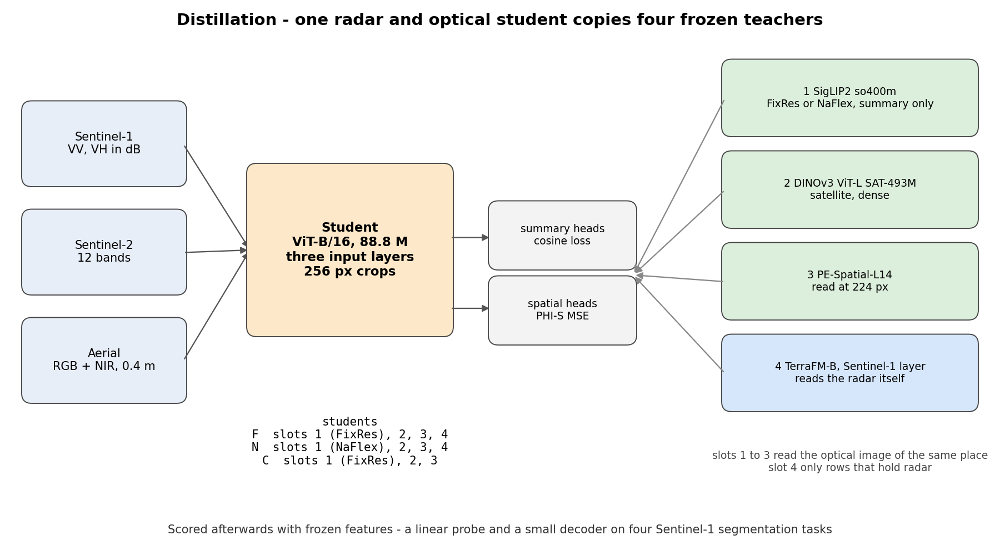
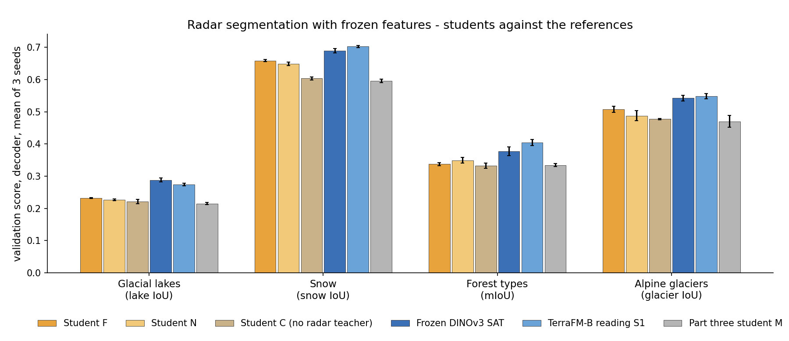
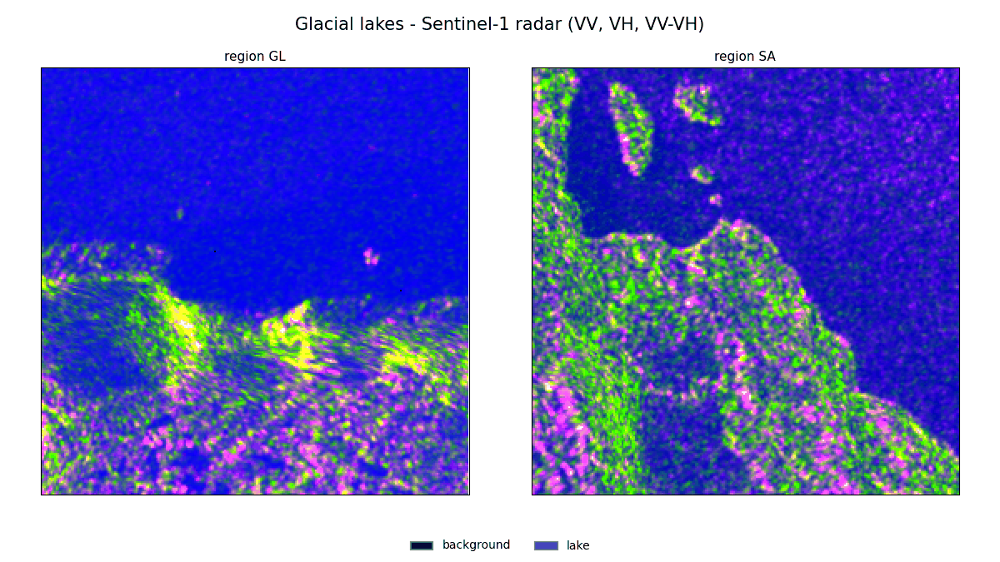
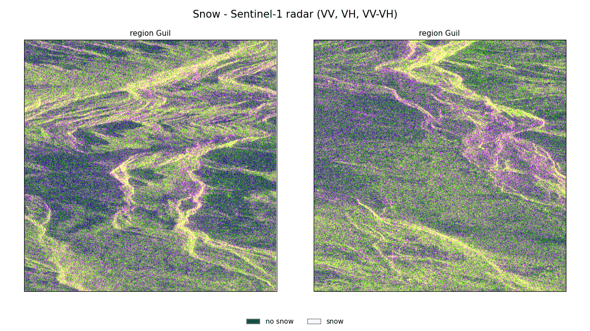
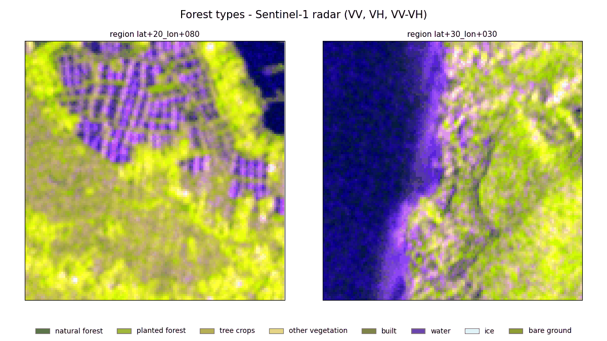
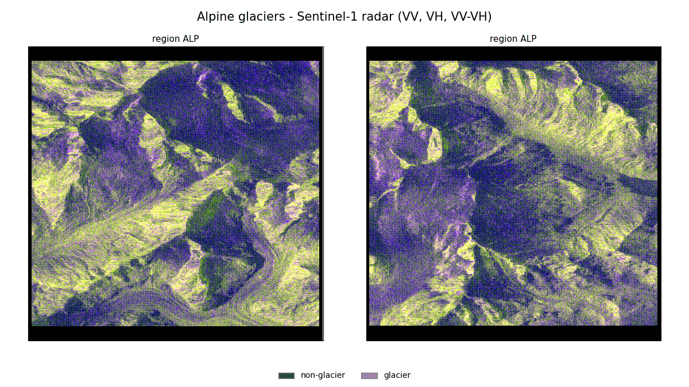
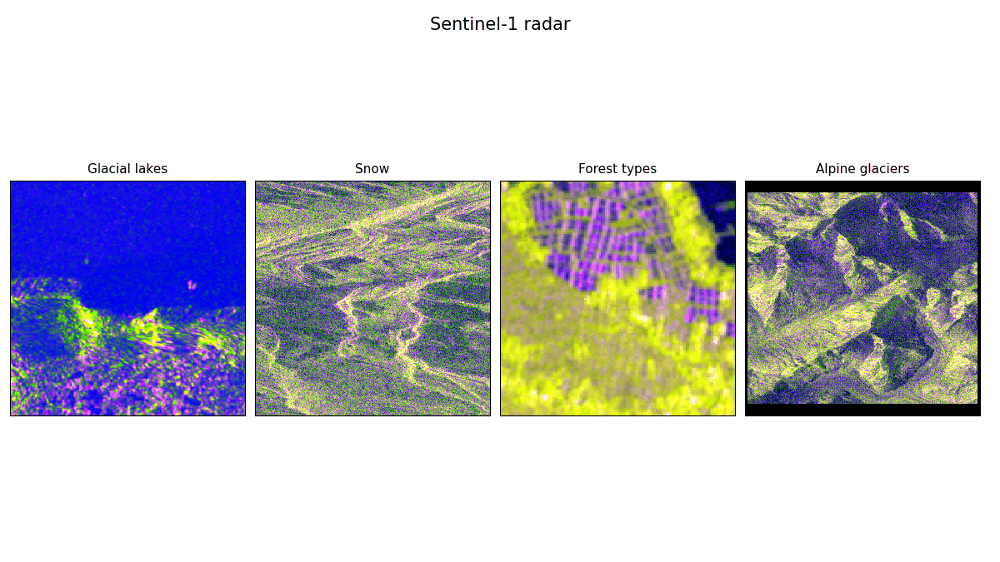

# Distilling frozen teachers into a Sentinel-1 radar student

Sentinel-1 is a radar satellite. Its images are free, global and see through clouds, but far fewer
models have been trained on radar than on ordinary photographs. This project asks whether a small
model can learn to read radar by copying the features of several large, frozen vision models at once,
and whether a teacher that reads radar itself makes that copy better. It is part four of a series on
how well frozen vision encoders transfer to Sentinel-1 radar segmentation.

In technical terms, a C-RADIO-style ViT-B student learns from the C-RADIOv4 teacher set, with the
satellite DINOv3 in the DINOv3 slot and one more teacher that reads the radar itself, and is then
scored with frozen features on four radar segmentation tasks. Every rule below was fixed before a
score was seen, and every result is reported the same way whether it is a gain or not.



**Where this sits in the series.** The earlier parts are not in this repository, and this page uses
only three things from them. Part two scored frozen encoders on the four radar datasets, converted
those datasets into one shared format and fixed the scoring step and its saved reference rows. Part
three built the pilot training data and trained the first student, M, from satellite teachers. Part
four, this repository, adds a teacher that reads radar and three further checks.

## Contents

- [Key findings](#key-findings)
- [Results at a glance](#results-at-a-glance)
- [Predictions on validation chips](#predictions-on-validation-chips)
- [What the models see](#what-the-models-see)
- [Method](#method)
- [Additional checks](#additional-checks)
- [Limitations](#limitations)
- [What is in this repository](#what-is-in-this-repository)
- [Reproducing](#reproducing)
- [Secrets, weights and provenance](#secrets-weights-and-provenance)
- [Licences and attribution](#licences-and-attribution)

## Key findings

- **The student does not reach the frozen satellite DINOv3.** The headline student F loses on all four
  radar datasets, by 0.030 to 0.055.
- **A radar-reading teacher helps.** With TerraFM-B reading Sentinel-1 as a fourth teacher, F wins on
  snow (+0.055) and alpine glaciers (+0.031) against the same student without it, and ties on lakes and
  forest. It never hurts.
- **SigLIP2 NaFlex or FixRes as the first teacher makes no difference** (4 ties).
- **The step from the earlier pilot comes from the radar teacher.** F beats the part three student on 3
  of the 4 radar datasets and on aerial images. The student without the radar teacher ties it on radar.
- **Three further checks change none of this** - a finer 8 px feature grid, radar coherence as an extra
  input and a compiled decoder step, each decided by a rule written before it ran.

## Results at a glance



The letters are the three students of this part, described under [Students](#students): **F** is the
headline student with all four teachers, **N** is F with SigLIP2 NaFlex in place of FixRes, **C** is F
without the radar teacher. **M** is the part three student. The last three columns are the references.

Decoder, validation splits, mean of 3 seeds (SD in brackets). The frozen satellite DINOv3 rows were
scored in part two, TerraFM-B reading Sentinel-1 and student M in part three, with the same run step.
The aerial row is reported for information and does not count towards any verdict.

| dataset | score | F | N | C | frozen DINOv3 SAT | TerraFM-B reading S1 | part three M |
|---|---|---|---|---|---|---|---|
| glacial lakes | IoU | 0.232 (0.001) | 0.227 (0.003) | 0.221 (0.006) | **0.288** (0.006) | 0.274 (0.004) | 0.215 (0.003) |
| snow | IoU | 0.659 (0.003) | 0.648 (0.005) | 0.603 (0.005) | 0.689 (0.007) | **0.703** (0.003) | 0.596 (0.005) |
| forest types | mIoU | 0.337 (0.005) | 0.349 (0.009) | 0.333 (0.008) | 0.377 (0.013) | **0.404** (0.009) | 0.334 (0.005) |
| alpine glaciers | IoU | 0.508 (0.009) | 0.488 (0.015) | 0.477 (0.002) | 0.542 (0.009) | **0.548** (0.008) | 0.470 (0.018) |
| aerial (reported) | mIoU | 0.347 (0.006) | 0.343 (0.008) | 0.341 (0.004) | **0.421** (0.014) | - | 0.304 (0.009) |

The five questions, each answered by the rule under [Evaluation](#evaluation). A row is a win, a loss
or a tie by a fixed margin, and the word in the last column follows from the count over the four radar
decoder rows.

| question | comparison | decoder rows | word |
|---|---|---|---|
| 1, the headline | F against the frozen satellite DINOv3 | 0 wins, 4 losses | does not reach |
| | N and C against it | 0 wins, 4 losses each | does not reach |
| 2, does a radar teacher help | F against C | 2 wins, 2 ties | matches |
| 3, NaFlex or FixRes | N against F | 4 ties | matches |
| 4, against the radar teacher | F and N against TerraFM-B reading Sentinel-1 | 0 wins, 4 losses each | does not reach |
| 5, against part three (informational) | F, N and C against student M | 3 wins 1 tie, 2 wins 2 ties, 4 ties | matches |

## Predictions on validation chips

Two validation chips per dataset, picked by a rule on the labels alone - the most even class mix among
the chips that are almost fully labelled, the second chip from another region where there is one. Each
GIF steps through the radar image, the truth and the predictions of the frozen satellite DINOv3,
student F and student C (without the radar teacher), with the score of every chip, and ends on all of
them together. Two chips can differ from the averages above - on these snow chips student F calls
almost everything snow - so the table, not the GIFs, carries the result.



Glacial lakes (lake IoU). On the Greenland chip the students trace the lake and the frozen DINOv3 does
not, on the Southern Andes chip the other way round.



Snow (snow IoU), Guil basin, French Alps.



Forest types (mIoU over the classes in the chip).



Alpine glaciers (glacier IoU). The black border of the tiles is padding and is not scored.

## What the models see



The patch features each model is scored with (the frozen DINOv3 at layer 21, the students at their last
layer), as colours (one PCA per image, the first three components). Colours compare patches inside one
image only.

## Method

### Teachers

| slot | teacher | reads | grid at 256 px | licence |
|---|---|---|---|---|
| 1 language-aligned | SigLIP2 so400m patch 16, [FixRes 256](https://huggingface.co/google/siglip2-so400m-patch16-256) or [NaFlex](https://huggingface.co/google/siglip2-so400m-patch16-naflex), summary target only | Sentinel-2 RGB thumbnail, or aerial RGB | 16 x 16 | Apache-2.0 |
| 2 self-supervised dense | [DINOv3 ViT-L/16 SAT-493M](https://huggingface.co/facebook/dinov3-vitl16-pretrain-sat493m) | same | 16 x 16 | DINOv3 License, gated |
| 3 segmentation-grade spatial | [Perception Encoder PE-Spatial-L14-448](https://huggingface.co/facebook/PE-Spatial-L14-448), read at 224 px | same | 16 x 16 | Apache-2.0 |
| 4 radar | [TerraFM-B](https://huggingface.co/MBZUAI/TerraFM) through its Sentinel-1 input layer | Sentinel-1 VV and VH in dB, rows with radar only | 14 x 14 | Apache-2.0 on the model card, see [Licences](#licences-and-attribution) |

All teachers are frozen. Slots 1 to 3 are the C-RADIOv4 recipe with the satellite DINOv3 in the DINOv3
slot and PE-Spatial in place of the SAM 3 encoder; slot 4 is new.

### Students

| student | teachers |
|---|---|
| F, the headline | SigLIP2 FixRes, DINOv3 SAT, PE-Spatial, TerraFM-B radar |
| N | as F with SigLIP2 NaFlex |
| C | as F without the radar teacher, the C-RADIOv4 shape |

ViT-B/16, 12 layers, 768-d, 88.8 M parameters with three input layers (Sentinel-1, Sentinel-2 with 12
bands, aerial RGB and near-infrared), trained from nothing at 256 px. Per teacher a summary head
(cosine loss) and a spatial head (MSE on PHI-S standardised features). The three students train in one
loop on the same batches with the same seed, the teachers running once per step.

### Data

19,988 Major-TOM Sentinel-1 and Sentinel-2 pairs at 384 px (17,988 for training, 2,000 held out by grid
cell) and 28,000 FLAIR-HUB aerial patches at 0.4 m. A batch of 128 holds 96 pairs, each read as radar,
optical or both, and 32 aerial patches. No label is used in distillation.

### Training

AdamW, peak learning rate 5e-4, 500 warm-up steps, cosine to 0, 6,250 steps (20 epochs over 40,000
samples). 1.47 s per step on an A100 80 GB for the teachers and all three students, about 2.7 hours of
training, peak 23.9 GB of GPU memory.

### Evaluation

Frozen features (the students' last layer, the frozen DINOv3 at layer 21), a linear probe on 16 px
patches and a small decoder with an image skip, trained with the seeds 0, 1 and 2, on four Sentinel-1
datasets and the FLAIR-HUB aerial validation set. A control run repeats one earlier run (forest, the
satellite DINOv3) and must agree with its saved numbers before anything else is scored.

The rule. A decoder row is a win when its seed mean is higher by more than 0.01 and by more than twice
the larger seed SD, a loss the same way round, otherwise a tie; a probe row is a win or a loss beyond
0.02. Over the 4 radar decoder rows, 4 wins and no loss is "beats", no loss is "matches", more wins
than losses is "mixed", otherwise "does not reach".

## Additional checks

Each check re-scores the frozen satellite DINOv3 in its own session, so its forest rows differ from the
part two row in the main table (0.377) by less than the seed spread.

**Compiled decoder.** torch.compile takes 39 and 38 percent off a decoder step at 512 and 992 px, but
it changed the result of a seed - the water IoU of forest moved by 0.020 in one run and by 0.013 the
other way in a check with six more seeds, while the plain step repeats the same seeds within 0.004.
Scoring keeps the plain step.

**8 px feature grid.** The frozen satellite DINOv3 with its features made twice as fine by AnyUp or by
bilinear interpolation, the probe and the decoder at 8 px.

| dataset, decoder | 16 px | AnyUp 8 px | bilinear 8 px |
|---|---|---|---|
| glacial lakes, lake IoU (decides) | 0.288 | 0.286 | 0.282 |
| forest types, mIoU | 0.386 | 0.406 | 0.406 |

A tie on lakes (a gap of 0.012 was needed), so the planned 8 px student was not trained.

**Radar coherence.** The 12-day VV coherence of the Global Seasonal Sentinel-1 Interferometric Coherence
and Backscatter Data Set (about 90 m, December 2019 to November 2020) as a second channel of the
decoder's image skip, on forest.

| forest types, val, decoder | as it is | with coherence |
|---|---|---|
| mIoU (decides) | 0.381 (0.013) | 0.391 (0.009) |
| water IoU | 0.691 (0.003) | 0.754 (0.001) |

A tie on mIoU (a gap of 0.027 was needed). Water is the one class it moves far outside the seed spread.

## Limitations

- Only the validation splits were scored. The test splits were kept for a final student that was not
  trained, so there is no test number.
- One schedule, one student seed, 18,000 training pairs; the held-out loss was still falling at the end.
- A ViT-B student of 88.8 M parameters against teachers of 113 M to 428 M. A larger student or more data
  were not tried.
- The student is trained at 256 px only, the scoring chips are 128 to 992 px.
- Slots 1 to 3 read a 10 m RGB thumbnail. PE-Spatial was trained at 448 px and is read at 224 px, SigLIP2
  NaFlex at one square size.
- Question 4 compares a student with the teacher it copies, a weaker test than an independent one.
- Frozen features only, nothing is fine-tuned on the segmentation tasks.
- Major-TOM is global, so the student has seen unlabelled images of the areas the radar tasks test on.

## What is in this repository

| folder | what |
|---|---|
| `notebooks/` | the eight Colab notebooks, in run order, published without code payload and without outputs |
| `src/sartransfer/` | the package - the teachers, the student, the training loop, the data readers, the scoring step and the figures. Vendored model code sits under `models/anyup/` and `distil/teachers/vendor/` with its own licence and notice |
| `tests/` | one script per module, run locally with tiny random models and no network |
| `docs/figures/` | the pictures of this page, made by notebook 05 |
| `docs/licences/` | dated records of what each teacher's licence pages said when they were read |
| `sync.py` | packs `src/` into the notebooks, see [Reproducing](#reproducing) |
| `.env.example` | the keys the notebooks read, with a note on each |

Student weights, teacher weights, data and results are not in the repository. Results and checkpoints
live on Google Drive, the data on Drive and in private Hugging Face repositories (see below).

## Reproducing

### What you need

- **A Colab runtime** with the GPU named in the table below. The notebooks were run from VS Code with the
  Colab extension, and work from the browser too.
- **A Hugging Face account** with access granted to the gated
  [DINOv3 weights](https://huggingface.co/facebook/dinov3-vitl16-pretrain-sat493m), and a read token.
  The other teacher weights are public and download on first use into a cache folder on Drive.
- **The inputs of the earlier parts.** Notebooks 02 to 05 read data that this repository does not
  contain and cannot build on its own - the pilot training data of part three (rebuilt by notebook 01,
  which also needs a write token for the upload cell), the four radar datasets in the prepared format of
  part two, and part two's saved result rows, which the control run of notebook 03 compares against.
  Without them the notebooks stop at their setup cell.

### Setting up

**The code.** The Colab runtime cannot see your disk, so the package source travels inside each
notebook, in a marked "sync cell" that unpacks it on the runtime. The published notebooks carry an
empty sync cell. On your machine, in the repository folder, run

```
python sync.py            # pack src/ into every notebook
python sync.py --check    # exit 1 if any notebook holds stale or no code
```

and open the notebook again. On a fresh clone `--check` reports every notebook as stale, which is
expected until the first `python sync.py`. The payload is deterministic, so an unchanged source tree
gives a byte-identical cell. Run `python sync.py --clear` before publishing, so no packed code is
committed, and `python sync.py --published` to check that every notebook is cleared and holds no
outputs - the CI runs that check on every commit.

**The `.env` file.** Settings and tokens come from a `.env` file; `.env.example` lists every key with a
note. A value already in the environment always wins over the file.

The loader prints, for each key, whether it is set, never a value. A missing token or Drive folder
that a notebook needs is asked for with a hidden prompt; the two optional keys are skipped, and a
missing `DATA_HF_REPO` or `MODEL_CACHE_DRIVE_DIR` stops with a message that names the key. Read the
[security note](#secrets-weights-and-provenance) before adding a token.

| key | what for |
|---|---|
| `HF_TOKEN` | a read token, for the gated DINOv3 weights and the private data copies |
| `HF_WRITE_TOKEN` | optional, a write token, only for the upload cell of notebook 01. When present, the scoring notebooks also use it to read the private dataset copies |
| `DATA_HF_REPO` | the private Hugging Face dataset repository of the pilot data, as `owner/name` |
| `DATA_DRIVE_DIR` | the folder under MyDrive that holds the pilot data, without the MyDrive prefix |
| `DATASET_HF_OWNER` | optional, the owner of the private copies of the four radar datasets; unset, they are copied from `MyDrive/datasets/` |
| `REFERENCE_DRIVE_DIR` | the folder under MyDrive with part two's saved results, read by the control and never written |
| `MODEL_CACHE_DRIVE_DIR` | the folder under MyDrive that keeps the downloaded model weights between sessions |

### Run order

Each notebook mounts Drive, unpacks the code, reads the `.env`, does its work, then flushes Drive and
releases the runtime. A notebook that finds its results already on Drive does not run them again.

| notebook | runtime | what | time |
|---|---|---|---|
| 01_data | - | builds the pilot data (pairs, aerial sets, statistics), kept so it can be rebuilt | not run here |
| 02_distil | A100 with High-RAM | trains students F, N and C in one loop | 2.8 h measured, the whole notebook |
| 03_score | A100 with High-RAM | the control, the scoring and the verdicts | 1 h 56 min measured |
| 03a_decoder_check | A100 | the compiled decoder step against the plain one | 9 min measured |
| 03b_grid_check | A100 | the 8 px grid, AnyUp and bilinear against 16 px | 24 min measured |
| 04a_coherence | CPU with High-RAM | the coherence of every forest chip | 6 min measured |
| 04b_coherence_score | L4 | the forest decoder with and without coherence | 6 min measured |
| 05_figures | L4 | the figures of this page | about 3 min after the data download |

### Tests

The tests run on a local machine with tiny random models and no network. They need PyTorch, which
Colab ships and `pyproject.toml` therefore does not list, and they refuse to start until `TMPDIR`,
`TEMP` and `TMP` all point to an existing folder (on Windows, one that is not on C:). From the
repository folder:

```
python tests/test_<name>.py
```

Tests that compare against real weights or read a few real Major-TOM rows are skipped unless
`SARTRANSFER_TEST_WEIGHTS` or `SARTRANSFER_TEST_NET=1` is set. `tests/test_notebook*.py` read the
notebooks themselves and check, among other things, that every sync cell is current or cleared.
`ruff` settings are in `pyproject.toml`.

GitHub Actions (`.github/workflows/ci.yml`) runs ruff, the published-notebook check and the offline
tests on the CPU on every pull request and every push to master. The tests that cannot run on a
GitHub runner are named in the workflow with their reasons - three need an NVIDIA driver because
they patch `torch.cuda.is_available` for the notebooks' GPU check, and one needs 70 GB of free disk.
The tests run one at a time there, as they should locally: the notebook dry runs time a stand-in
Hub and fail when they share the machine with other tests.

## Secrets, weights and provenance

- **Tokens never leave the process in the clear.** They are read from the `.env` file or a hidden
  prompt, passed to `huggingface_hub` only, and masked in the error messages the scorer and the
  account check print.
- **Keep the `.env` file private.** Use read-only, short-lived tokens, add the write token only for the
  upload cell of notebook 01 and remove it afterwards.
- **The published notebooks hold no code payload and no outputs.** `.env`, keys and checkpoints are
  gitignored. Only `*.py` files and `pyproject.toml` are packed into the sync cell, by an explicit
  allowlist.
- **Every teacher's weights are pinned to a Hugging Face revision**, so a changed upstream repository
  cannot change a result silently. Checkpoints are loaded with `weights_only=True`, no model is loaded
  with remote code, and the AnyUp weights are checked by size and full SHA-256 against the authors'
  release.

## Licences and attribution

- Code of this repository - MIT (LICENSE). Vendored code keeps its own licence and notice, in
  `docs/licences/` and next to the vendored folders:
  [PE-Spatial](https://github.com/facebookresearch/perception_models) (Apache-2.0),
  [AnyUp](https://github.com/wimmerth/anyup) (CC BY 4.0), and the
  [TerraFM](https://github.com/mbzuai-oryx/TerraFM) model file, whose licence is not settled by its
  authors - Apache-2.0 on the Hugging Face model card, MIT in the authors' reply to a GitHub issue, and
  no licence file in the GitHub repository when it was read. The vendored copy carries the Apache-2.0
  text; `docs/licences/terrafm-2026-09-29.md` records the three statements with their dates.
- Teacher weights are not included. SigLIP2 (google/siglip2-so400m-patch16-256 and -naflex) and
  PE-Spatial (facebook/PE-Spatial-L14-448) are Apache-2.0. DINOv3 (facebook/dinov3-vitl16-pretrain-sat493m)
  is under the DINOv3 License; whether a student distilled from it is a derivative work is not settled,
  so the student weights are not published. Built with DINOv3. TerraFM-B is from MBZUAI/TerraFM.
- [Major-TOM](https://huggingface.co/Major-TOM) (Francis and Czerkawski, IGARSS 2024), CC-BY-SA-4.0,
  contains modified Copernicus Sentinel data. [FLAIR-HUB](https://huggingface.co/datasets/IGNF/FLAIR-HUB)
  by IGN (Garioud et al., ISPRS Journal of Photogrammetry and Remote Sensing 237, 2026),
  [Etalab Open Licence 2.0](https://github.com/etalab/licence-ouverte/blob/master/open-licence.md).
- Glacial-Lake-Bench (Kaushik, Tellman, Howat, Haritashya and Maurya), CC BY 4.0. Snow cover data of
  Briand, Weissgerber, Lobry and Idier (Recherche Data Gouv, [doi 10.57745/IMTSFL](https://doi.org/10.57745/IMTSFL)),
  Etalab Open Licence 2.0. ForTy v1 (Jiang and Neumann, IGARSS 2025), CC BY-SA 4.0. GlaViTU tiles
  (Maslov et al., Nature Communications 16, 43, 2025), CC BY 4.0.
- Coherence from the Global Seasonal Sentinel-1 Interferometric Coherence and Backscatter Data Set
  (Kellndorfer et al., Scientific Data 9, 73, 2022), CC BY 4.0, read from its public bucket and not
  redistributed here.
- Method references - AM-RADIO ([arXiv 2312.06709](https://arxiv.org/abs/2312.06709)), PHI-S
  ([arXiv 2410.01680](https://arxiv.org/abs/2410.01680)), SigLIP 2 ([arXiv 2502.14786](https://arxiv.org/abs/2502.14786)),
  DINOv3 ([arXiv 2508.10104](https://arxiv.org/abs/2508.10104)), Perception Encoder
  ([arXiv 2504.13181](https://arxiv.org/abs/2504.13181)), TerraFM ([arXiv 2506.06281](https://arxiv.org/abs/2506.06281)),
  AnyUp ([arXiv 2510.12764](https://arxiv.org/abs/2510.12764)).
